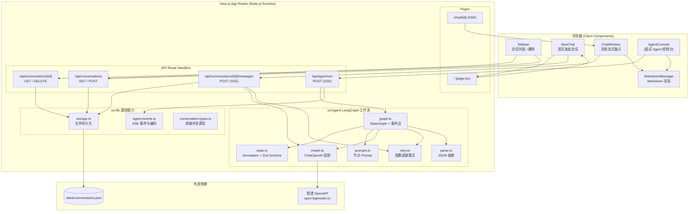
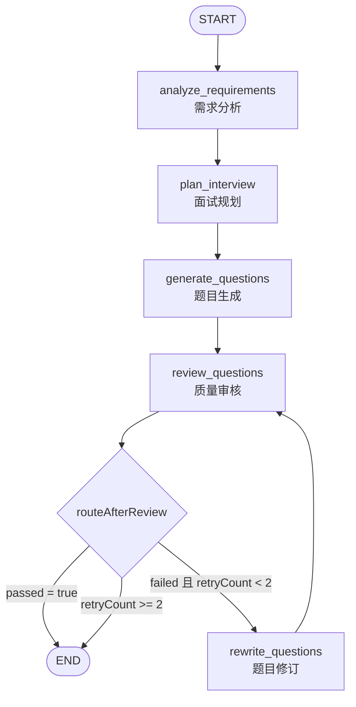
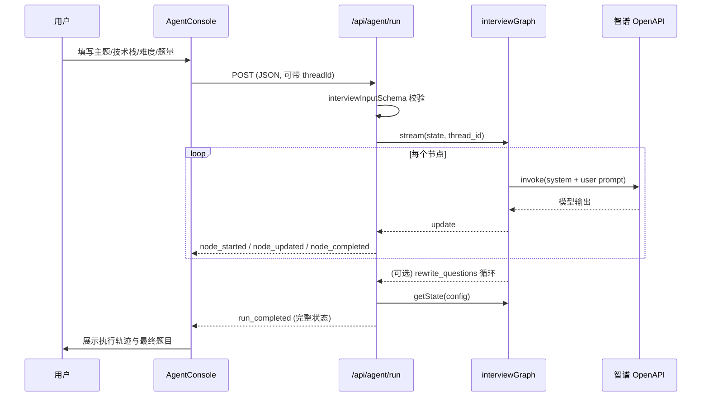
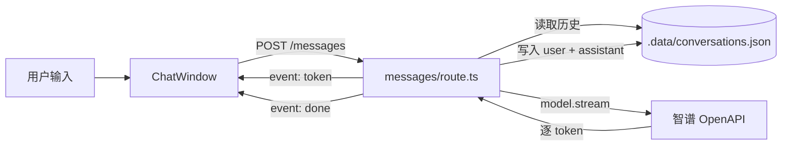

# Agent Interview Lab 架构图

本文基于当前代码库产出，描述整体分层、LangGraph 工作流、SSE 事件链路与数据持久化。

## 1. 系统分层架构

## 2. LangGraph 工作流

状态在节点间传递，审核节点通过条件边决定结束或进入修订循环（最多重写 2 次）。

图状态（`src/agent/state.ts`）：

| 字段 | 类型 | 说明 |
| --- | --- | --- |
| `topic` / `techStack` | `string` | 面试主题与技术栈 |
| `difficulty` | `beginner` \| `intermediate` \| `advanced` | 难度等级 |
| `questionCount` | `number` | 题目数量（1–10） |
| `analysis` | `string` | 能力画像，`analyze_requirements` 产出 |
| `plan` | `string` | 面试题结构规划，`plan_interview` 产出 |
| `questions` | `InterviewQuestion[]` | 结构化题目，生成/修订节点产出 |
| `review` | `InterviewReview` | 审核结果（passed / score / feedback） |
| `retryCount` | `number` | 已修订次数，用于条件边判定 |
| `currentNode` | `string` | 当前节点名 |
| `errors` | `string[]` | 累积错误信息 |

结构化输出使用 Zod 校验：`questionsSchema`（题目数组）与 `reviewSchema`（审核结果），模型返回经 `parse.ts` 抽取 JSON 后解析。

## 3. 面试 Agent SSE 事件链路

`POST /api/agent/run` 使用 `interviewGraph.stream(..., { streamMode: "updates" })` 逐节点推送事件，`MemorySaver` 以 `thread_id` 保存图状态。

SSE 事件类型（`src/lib/agent-events.ts`）：`node_started`、`node_updated`、`node_completed`、`node_failed`、`run_completed`，以及聊天链路的 `token`、`done`、`error`。

## 4. 会话聊天链路

与面试 Agent 相互独立：`/api/conversations/[id]/messages` 直接调用模型流式输出（不走 LangGraph），并把完整消息历史落盘。

## 5. 目录职责

| 目录 | 职责 |
| --- | --- |
| `app/` | 页面、布局与 API Route Handler |
| `app/api/agent/run/` | 面试 Agent 的 SSE 入口 |
| `app/api/conversations/` | 会话增删查与消息流式接口 |
| `src/agent/` | LangGraph 状态、节点、条件边、Prompt、模型适配、重试与解析 |
| `src/lib/` | 文件持久化、SSE 事件编码、前端共享类型 |
| `components/` | 侧边栏、会话窗口、Agent 控制台、Markdown 渲染 |

## 6. 安全与运行约束

- `ZHIPU_API_KEY` 仅在服务端读取（`model.ts`），不会进入客户端 bundle 或 SSE 事件。
- 所有 API Route 使用 `runtime = "nodejs"` 与 `dynamic = "force-dynamic"`。
- 模型调用经 `retry.ts` 指数退避，处理智谱 429 / 业务码 1305 过载。
- 会话数据存储于本地 `.data/conversations.json`；面试图状态仅存于进程内 `MemorySaver`，重启即失效。
